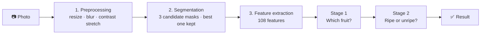
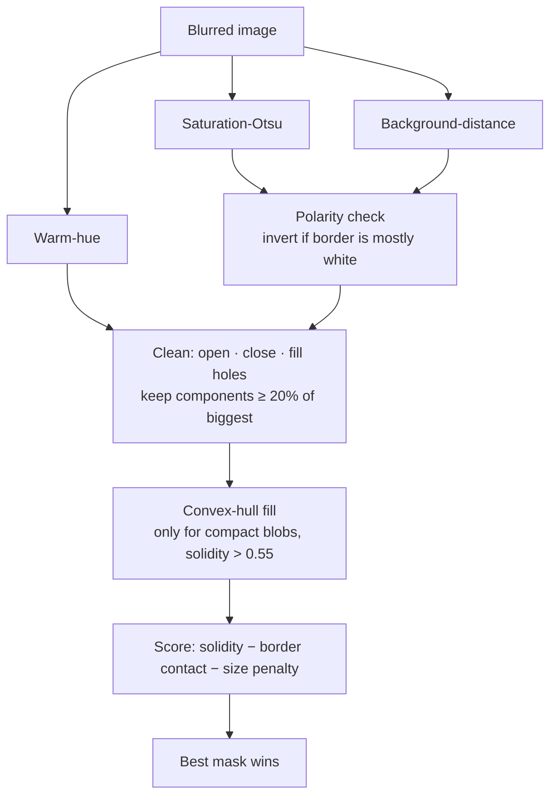

<div align="center">

# 🍎 🍌 🍊 Fruit Ripeness Detection System

**Is it an apple, a banana or an orange, and is it ripe?**
Answered with classical image processing alone. No neural networks, no training, no black boxes.


</div>

---

## 📖 Overview

Upload a photo of an **apple, banana or orange** and the system answers two questions:

1. **Which fruit is it?**
2. **Is it ripe or unripe?**

It works by turning every image into a **108-number feature vector** (colour, shape, texture) and comparing it with **six class-average vectors** built from your reference images. Nothing is trained: there are no weights, no gradient descent and no fitted model. Every decision is simply a distance between two vectors, so you can always see *why* the system answered what it did.

A **Streamlit dashboard** shows each step of the pipeline on your uploaded image, so the whole process is visible, not hidden.

### ⚡ At a glance

| | |
|---|---|
| **Fruits** | Apple · Banana · Orange |
| **Output** | Fruit type + ripe / unripe, with a margin for each decision |
| **Segmentation** | 3 candidate masks (saturation-Otsu, background-distance, warm-hue); the most reliable one wins |
| **Features** | 108 handcrafted features in 6 groups |
| **Classifier** | Two-stage nearest-reference-vector, group-weighted distance |
| **Reference data** | One dataset folder, averaged into 6 class vectors, saved to `prototypes.npz` |
| **Interface** | Streamlit dashboard |

---

## 📑 Table of Contents

- [✨ Highlights](#-highlights)
- [🔬 How It Works](#-how-it-works)
- [🧬 Feature Set](#-feature-set)
- [🎯 Classification Method](#-classification-method)
- [📁 Project Structure](#-project-structure)
- [🗂️ Dataset Layout](#️-dataset-layout)
- [🚀 Installation](#-installation)
- [▶️ Usage](#️-usage)
- [🖥️ The Dashboard](#️-the-dashboard)
- [🎛️ Tuning the Classifier](#️-tuning-the-classifier)
- [⚠️ Limitations](#️-limitations)
- [🛠️ Tech Stack](#️-tech-stack)

---

## ✨ Highlights

- 🧠 **Strictly classical.** Resizing, Gaussian blur, contrast stretching, HSV / Lab colour spaces, Otsu thresholding, morphology, convex hulls, GLCM, LBP and Canny edges. Nothing is learned.
- 🪜 **Two-stage decision.** Stage 1 picks the fruit (shape and hue matter most). Stage 2 picks ripe vs. unripe using only that fruit's two references (colour matters most).
- 🎭 **Multi-candidate segmentation.** Three different masks are generated and scored. The one with the best solidity and the least border contact is used, so it copes with both plain studio backgrounds and cluttered scenes.
- 🛡️ **Self-aware.** If the mask looks wrong, shape features are switched off automatically and the dashboard shows a warning instead of silently trusting a bad result.
- 🔍 **Fully explainable.** The dashboard shows all 8 pipeline images, the distance to every class vector and all 108 extracted features.
- 🔄 **Dataset-agnostic.** Point the sidebar at any folder with the right layout and rebuild. No code changes.
- 📦 **Zero training time.** Building the reference vectors is just feature extraction plus averaging.

---

## 🔬 How It Works



### 1️⃣ Preprocessing

| Step | Detail | Purpose |
|---|---|---|
| **Resize** | 256 × 256 | Comparable features and fast processing |
| **Gaussian blur** | 5×5 kernel, σ = 1 | Suppresses noise before thresholding |
| **Contrast stretching** | 2nd–98th percentile → 0–255 | Normalises dull or bright photos |

> The stretched image is used **only to help build the mask**. Features are measured on the resized original, so true colours are preserved.

### 2️⃣ Segmentation

Three candidate masks are produced, cleaned and scored:

| Candidate | Idea | Best for |
|---|---|---|
| **Saturation-Otsu** | Otsu threshold on the HSV saturation channel | General case |
| **Background-distance** | Distance of each pixel from the border colour in Lab space (lightness weighted low so soft shadows are ignored), then Otsu | Plain, uniform backgrounds |
| **Warm-hue** | Saturated red / orange / yellow pixels only | Ripe fruit in cluttered scenes, such as oranges on a tree |



After a winner is chosen:

- **Segmented fruit = mask × original image.**
- A **core mask** (mask eroded by 2 iterations of a 3×3 kernel) is made so blended edge pixels don't pollute colour and texture statistics.
- A **reliability check** flags the mask as unreliable unless solidity > 0.55, border contact < 25 % and area is between 2 % and 85 % of the image.

### 3️⃣ Feature extraction

Each image becomes a **108-dimensional vector** (details in the next section).

### 4️⃣ Building reference vectors

- Extract features from every image in the dataset folder.
- Standardise with the mean and standard deviation of all images (clipped to ±4).
- Average each class to get **6 reference vectors**. Images with unreliable masks are left out of the average (unless that would leave a class with fewer than 3 images).
- Save everything to `prototypes.npz`.

### 5️⃣ Prediction

- **Stage 1:** the nearest reference vector decides the fruit.
- **Stage 2:** the ripe vs. unripe reference of that fruit decides the ripeness.

---

## 🧬 Feature Set

Each image produces **108 features** in six groups.

| Group | Features | Measured on |
|---|:---:|---|
| 🎨 **A. Colour (core)** | 18 | Core mask (eroded fruit) |
| 📐 **B. Shape** | 10 | Cleaned binary mask |
| 🔍 **C. Texture (core)** | 25 | Core mask |
| 🌍 **D. Global colour** | 18 | Whole fruit mask |
| 🌈 **E. Hue histogram** | 12 | Whole fruit mask |
| 🌐 **F. Global texture** | 25 | Whole fruit mask |
| **Total** | **108** | |

<details>
<summary><b>🎨 Colour features (18), used in groups A and D</b></summary>

| Features | Count | Notes |
|---|:---:|---|
| Hue sin-mean, cos-mean, circular std | 3 | Hue is circular (red wraps around 0°/360°), so it is averaged on a circle. Colourless pixels are ignored. |
| Saturation mean, std, skew | 3 | Vividness |
| Value mean, std, skew | 3 | Brightness, dark or shiny regions |
| Lab *a* and *b* mean, std | 4 | Green↔red and blue↔yellow axes, which shift strongly during ripening |
| Colour-band fractions | 5 | Fraction of red, orange, yellow, green and dark pixels |

</details>

<details>
<summary><b>🔍 Texture features (25), used in groups C and F</b></summary>

| Features | Count | Notes |
|---|:---:|---|
| **GLCM** (distances 1 and 3, four angles) | 14 | Contrast, dissimilarity, homogeneity, energy, correlation, ASM and entropy, on 32 gray levels with the background ignored |
| **LBP histogram** | 10 | Uniform local binary patterns (P = 8, R = 1) |
| **Edge density** | 1 | Canny edge fraction inside the eroded fruit, which captures spots and blemishes |

</details>

<details>
<summary><b>📐 Shape features (10), group B</b></summary>

Area fraction, normalised perimeter, circularity, aspect ratio (minimum-area rotated rectangle), eccentricity, solidity, extent and Hu moments 1–3.

</details>

<details>
<summary><b>🌈 Hue histogram (12), group E</b></summary>

Hue (0–360°) of the fruit pixels only, in twelve 30° bins, ignoring colourless pixels. Normalised so it always sums to 1. This gives a very direct "how much green vs. yellow vs. red" fingerprint.

</details>

> [!NOTE]
> **Why both "core" and "global" groups?** The core mask avoids blurry edge pixels, but a small or odd mask can make it too tight. Measuring colour and texture on the whole fruit mask as well gives the classifier a second, more forgiving view of the same fruit.

---

## 🎯 Classification Method

### 📌 Reference vectors
For each of the **6 classes** (apple / banana / orange × ripe / unripe), the **average standardised feature vector** of its reference images is stored as that class's prototype.

### 📏 Weighted distance
For a new image:

1. Standardise its features with the dataset's mean and std, clipped to ±4 so no single outlier feature dominates.
2. Multiply the difference to each reference by a **per-feature weight**.
3. Distance = Euclidean norm of the weighted difference.

Each feature's weight is its **group weight divided by √(group size)**, so a large group (texture, 25 features) cannot swamp a small one (shape, 10).

### 🪜 Two stages

| Stage | Question | How it decides | Weights favour |
|---|---|---|---|
| **Stage 1** | Which fruit? | A fruit's distance is the smaller of its ripe and unripe distances. The nearest fruit wins. | Shape (1.5), colour (1.0), hue histogram (1.0) |
| **Stage 2** | Ripe or unripe? | Only the two references of the predicted fruit are compared. | Colour (1.5), hue histogram (1.5), global colour (1.0) |

The **margin** shown in the app is `1 − (nearest distance ÷ second-nearest distance)`. A larger margin means a more decisive answer.

> [!TIP]
> If the segmentation is flagged as unreliable, the shape group is given weight 0 in both stages, so a bad mask cannot mislead the fruit decision.

---

## 📁 Project Structure

```
Ripenessdetection/
├── app.py              # Streamlit dashboard (front end)
├── core.py             # Pipeline: segmentation, features, reference vectors, classifier
├── prototypes.npz      # Auto-generated reference vectors (rebuilt from the sidebar)
├── requirements.txt    # Python dependencies
├── README.md
├── .gitignore
└── dataset/            # Your image data (not tracked by Git)
    └── dataset1/
        ├── apples/
        ├── banana/
        └── orange/
```

---

## 🗂️ Dataset Layout

Labels are read from **folder names**. Each fruit folder needs a ripe and an unripe sub-folder:

```
dataset/
└── dataset1/
    ├── apples/
    │   ├── raw/      (or unripe/)
    │   └── ripe/
    ├── banana/
    │   ├── raw/
    │   └── ripe/
    └── orange/
        ├── raw/
        └── ripe/
```

**Recognised folder names** (case-insensitive, matched anywhere in the path below the dataset folder)

| Meaning | Accepted names |
|---|---|
| 🍎 Apple | `apple`, `apples` |
| 🍌 Banana | `banana`, `bananas` |
| 🍊 Orange | `orange`, `oranges` |
| 🟢 Unripe | `raw`, `unripe`, `green` |
| 🟠 Ripe | `ripe` |

Supported image formats: `.jpg`, `.jpeg`, `.png`, `.bmp`, `.webp`.

There is **no train / test split**: all images in the folder are used to build the reference vectors. Every one of the six classes needs at least one usable image.

---

## 🚀 Installation

**Requirements:** Python 3.9+

```bash
# 1. Clone the repository
git clone https://github.com/<your-username>/<your-repo>.git
cd <your-repo>

# 2. (Recommended) create a virtual environment
python -m venv .venv

# Windows
.venv\Scripts\activate
# macOS / Linux
source .venv/bin/activate

# 3. Install dependencies
pip install -r requirements.txt
```

**Dependencies:** `numpy`, `opencv-python`, `scikit-image`, `scipy`, `pandas`, `streamlit`.

Place your dataset in the `dataset/` folder following the [layout above](#️-dataset-layout).

---

## ▶️ Usage

```bash
streamlit run app.py
```

1. In the sidebar, check the **Dataset folder** (default `dataset/dataset1`).
2. Click **Build / rebuild reference vectors**. This extracts features from every image and saves `prototypes.npz`.
3. Open the **Predict + pipeline** tab and upload a photo.

On later launches the saved `prototypes.npz` is loaded automatically, so you only rebuild when your dataset changes. If the feature definitions in `core.py` change (`FEATURE_VERSION`), the old file is ignored and you are asked to rebuild.

### Using a different dataset

No code changes needed. Put the new images in a folder with the [same structure](#️-dataset-layout), type its path into the sidebar and click **Build / rebuild reference vectors**. Absolute paths (for example `D:/data/fruits`) also work.

To change the default path shown when the app opens, edit the `st.sidebar.text_input` line near the top of `app.py`.

---

## 🖥️ The Dashboard

| Tab | What it shows |
|---|---|
| **🔍 Predict + pipeline** | Upload a photo and get the fruit, the ripeness and both margins. Below that, the 8 pipeline images (resized → blur → contrast stretch → S-channel → best candidate mask → cleaned mask → core mask → segmented fruit), whether the background was plain or cluttered, distance charts for both stages, the hue histogram and a table of all 108 features |
| **🧮 Reference vectors** | How many images were averaged for each class, and the six standardised reference vectors across all 108 features |

**Sidebar:** dataset folder path and the build / rebuild button.

---

## 🎛️ Tuning the Classifier

Everything that controls the decision lives at the top of `core.py`, so it is easy to experiment:

| Setting | What it does |
|---|---|
| `FRUIT_W` | Group weights for Stage 1 (which fruit) |
| `COND_W` | Group weights for Stage 2 (ripe vs. unripe) |
| `Z_CLIP` | Limits the influence of any single outlier feature |
| `IMG_SIZE` | Working resolution for all processing |
| `GLCM_LEVELS`, `GLCM_DIST` | Texture quantisation and pixel distances |

Weight changes take effect immediately. If you change anything that alters the **features** themselves, bump `FEATURE_VERSION` so stale reference vectors are rejected.

---

## ⚠️ Limitations

- **Segmentation is the weak point.** Green fruit against green leaves, or fruit that blends into its background, can produce a poor mask. The app warns you when the mask looks unreliable, but the answer can still be wrong.
- **Single dominant fruit.** The pipeline expects one main fruit (or a tight cluster) per image.
- **Reference quality matters.** Because the classifier compares against class averages, a small or mislabelled dataset directly lowers accuracy.
- **Lighting.** Strong colour casts (for example heavy yellow indoor lighting) can shift hue and saturation statistics.

---

## 🛠️ Tech Stack

| Area | Tools |
|---|---|
| **Language** | Python |
| **Image processing** | OpenCV, scikit-image, SciPy |
| **Numerics / data** | NumPy, pandas |
| **Front end** | Streamlit |
