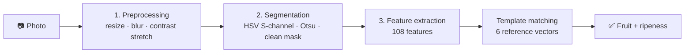

<div align="center">

# 🍎 🍌 🍊 Fruit Ripeness Detection System

**Is it an apple, a banana or an orange — and is it ripe?**
Answered with traditional image processing alone. Every step is a hand-written, explainable operation.


</div>

---

## 📖 Overview

Give the system a photo of an **apple, banana or orange** and it answers two questions:

1. **Which fruit is it?**
2. **Is it ripe or unripe?**

It uses a **traditional image processing** approach: preprocessing, HSV/Otsu segmentation, morphology, handcrafted **colour, texture and shape features**, and **template matching** against class reference vectors. Every decision can be traced back to a distance between feature vectors, so the whole system is fully explainable. An interactive **Streamlit dashboard** shows every stage of the pipeline for each uploaded image.

### ⚡ At a glance

| | |
|---|---|
| **Fruits** | Apple · Banana · Orange |
| **Output** | Fruit type + ripe / unripe |
| **Approach** | Traditional image processing |
| **Segmentation** | HSV saturation channel + Otsu thresholding |
| **Features** | 108 handcrafted features in 6 groups |
| **Matching** | Nearest reference vector (template matching), Euclidean distance on standardised features |
| **Reference data** | Train folder only (no test split) |
| **Interface** | Streamlit dashboard |

---

## 📑 Table of Contents

- [✨ Highlights](#-highlights)
- [🔬 How It Works](#-how-it-works)
- [🧬 Feature Set](#-feature-set)
- [🎯 Classification Method](#-classification-method)
- [📁 Project Structure](#-project-structure)
- [🗂️ Dataset Layout](#️-dataset-layout)
- [🚀 Installation](#-installation)
- [▶️ Usage](#️-usage)
- [🔄 Using a Different Dataset](#-using-a-different-dataset)
- [🖥️ The Dashboard](#️-the-dashboard)
- [📊 Evaluation](#-evaluation)
- [🛠️ Tech Stack](#️-tech-stack)

---

## ✨ Highlights

- 🧠 **Traditional image processing pipeline.** Resize, Gaussian blur, contrast stretching, HSV/Otsu segmentation, morphological cleaning, GLCM and LBP texture, and shape descriptors. No neural networks, no learned weights, no scikit-learn.
- 📚 **Reference vectors from sample images.** The 6 class reference vectors are the mean feature vectors of the training images, and the scaling statistics come from the same images. Everything else is fixed, hand-written image processing.
- 🎯 **Single nearest-vector decision.** The closest of the 6 class reference vectors gives both the fruit and its ripeness.
- 🔢 **108 handcrafted features** across six groups: fruit colour, shape, fruit texture, whole-image colour, hue histogram and whole-image texture.
- 🌍 **Mask-independent features.** The whole-image groups (D, E, F) do not depend on the segmentation mask.
- 🛡️ **Reliability check.** Solidity, border contact and area fraction flag masks that look wrong, and the app shows a warning.
- 🖥️ **Interactive dashboard** showing all 8 pipeline stages, distances to each class and the full feature vector.
- 🔄 **Dataset-agnostic.** Switch the train folder from the sidebar, with no code changes.

---

## 🔬 How It Works



### 1️⃣ Preprocessing

| Step | Detail | Purpose |
|---|---|---|
| **Resize** | Plain 256 × 256 | Comparable features and fast processing |
| **Gaussian blur** | 5×5 kernel, σ = 1 | Suppresses small noise before thresholding |
| **Contrast stretching** | 2nd–98th percentile → 0–255, same range for all channels | Makes the image clearer without shifting hue |

> The stretched image is used **only to build the mask**. All features are measured on the resized original, so true colours are preserved.

### 2️⃣ Segmentation

1. Convert the preprocessed image to **HSV** and take the **saturation (S) channel**.
2. Apply **Otsu thresholding**, which finds the best threshold from the saturation histogram and turns every pixel white (255) or black (0) to give a binary mask.
3. **Polarity check:** invert the mask if more than half of its border pixels are white, so the object is white.
4. Clean the mask: morphological opening, closing, hole filling, then keep the largest connected component.
5. **Segmented fruit = mask × original image.**
6. Erode the cleaned mask by 2 px to get the *core mask*, so blended edge pixels don't pollute colour and texture statistics.
7. A reliability check (solidity, border contact, area fraction) flags masks that look wrong.

The outputs passed on are the resized original image, the core mask and the cleaned mask (used for shape).

### 3️⃣ Feature extraction

Each image becomes a **108-dimensional feature vector** (details in the next section).

### 4️⃣ Building the reference vectors

- Extract the 108 features of every image in the train folder.
- Average them per class to get **6 reference vectors**.
- **Standardise** with the mean and standard deviation of all training image vectors.
- Save everything to `prototypes.npz`.

### 5️⃣ Prediction

- Extract the 108 features of the uploaded image and standardise them the same way.
- Compute the Euclidean distance to each of the 6 reference vectors.
- The nearest one wins, and its class name (for example `apple_ripe`) gives both the fruit and the ripeness.

---

## 🧬 Feature Set

Each image is converted into a **108-dimensional feature vector** in six groups.

| Group | Features | Measured on |
|---|:---:|---|
| 🎨 **A. Fruit colour** | 18 | Fruit only (core mask) |
| 📐 **B. Shape** | 10 | Cleaned binary mask |
| 🔍 **C. Fruit texture** | 25 | Fruit only (core mask) |
| 🌍 **D. Global colour** | 18 | Whole image |
| 🌈 **E. Hue histogram** | 12 | Whole image |
| 🌐 **F. Global texture** | 25 | Whole image |
| **Total** | **108** | |

<details>
<summary><b>🎨 Group A: Fruit colour (18)</b></summary>

| Features | Count | Notes |
|---|:---:|---|
| Hue sin-mean, cos-mean, circular std | 3 | Hue is circular (red wraps around 0°/360°), so it is averaged on a circle |
| Saturation mean, std, skew | 3 | Vividness |
| Value mean, std, skew | 3 | Brightness, dark or shiny regions |
| Lab *a* and *b* mean, std | 4 | Green↔red and blue↔yellow axes, which shift strongly during ripening |
| Colour-band fractions | 5 | Fraction of red, orange, yellow, green and dark pixels |

</details>

<details>
<summary><b>📐 Group B: Shape (10)</b></summary>

Area fraction, normalised perimeter, circularity, aspect ratio (minimum-area rotated rectangle), eccentricity, solidity, extent and Hu moments 1–3, all computed from the cleaned binary mask.

</details>

<details>
<summary><b>🔍 Group C: Fruit texture (25)</b></summary>

| Features | Count | Notes |
|---|:---:|---|
| **GLCM** (distances 1 and 3, angles 0°/45°/90°/135°) | 14 | Contrast, dissimilarity, homogeneity, energy, correlation, ASM and entropy, computed on the fruit only (32 gray levels, background ignored) |
| **LBP histogram** | 10 | Uniform local binary patterns (P = 8, R = 1) |
| **Edge density** | 1 | Canny edge fraction inside the fruit, which captures spots and blemishes |

Pipeline: raw image → grayscale → core mask → normalise intensities → GLCM, LBP and edge density.

</details>

<details>
<summary><b>🌍 Group D: Global colour (18)</b></summary>

The Group A colour features computed over the **whole frame** (full mask, all pixels white).

</details>

<details>
<summary><b>🌈 Group E: Hue histogram (12)</b></summary>

Raw image → HSV → the hue range (0°–360°) split into **12 bins** of 30°, computed over the whole image and normalised by the pixel count.

</details>

<details>
<summary><b>🌐 Group F: Global texture (25)</b></summary>

The Group C texture features computed over the **whole frame** (full mask).

</details>

> [!NOTE]
> **Why global features?** They don't depend on the segmentation mask, so they still describe the scene when the fruit cannot be separated from the background. The trade-off is that a strongly coloured background (blue sky, wooden table) also feeds into them.

---

## 🎯 Classification Method

### 📌 Reference vectors
For each of the **6 classes** (apple / banana / orange × ripe / unripe), the **mean feature vector** of its training images is stored as that class's reference vector (a template). These are then standardised using the mean and standard deviation of all training image vectors, and saved in `prototypes.npz`.

### 📏 Distance metric: Euclidean
1. The uploaded image's 108 features are standardised with the same mean and standard deviation.
2. The **Euclidean distance** to each of the 6 reference vectors is computed.
3. The **nearest** reference vector wins, and its class name gives both the fruit and the ripeness.
4. The **margin** shown in the app is `1 − (nearest distance ÷ second-nearest distance)`. It shows how clearly one class beat the runner-up and is not a probability.

---

## 📁 Project Structure

```
FruitRipeness/
├── app.py              # Streamlit dashboard (front end)
├── core.py             # Core pipeline: segmentation, features, reference vectors, matching
├── prototypes.npz      # Auto-generated reference vectors (not tracked by Git)
├── requirements.txt    # Python dependencies
├── README.md
├── .gitignore
└── dataset/            # Your image data (not tracked by Git)
    └── dataset1/
        └── train/
```

> If your backend module has a different file name, make sure the `import` line at the top of `app.py` matches it.

---

## 🗂️ Dataset Layout

The loader reads labels from **folder names**:

```
dataset/
└── dataset1/
    └── train/
        ├── apples/
        │   ├── raw/      (or unripe/)
        │   └── ripe/
        ├── banana/
        │   ├── raw/
        │   └── ripe/
        └── orange/
            ├── raw/
            └── ripe/
```

**Recognised folder names** (case-insensitive)

| Meaning | Accepted names |
|---|---|
| 🍎 Apple | `apple`, `apples` |
| 🍌 Banana | `banana`, `bananas` |
| 🍊 Orange | `orange`, `oranges` |
| 🟢 Unripe | `raw`, `unripe`, `green` |
| 🟡 Ripe | `ripe` |

Supported image formats: `.jpg`, `.jpeg`, `.png`, `.bmp`, `.webp`.

Only the train folder is used. There is no test folder and no train/test split.

---

## 🚀 Installation

**Requirements:** Python 3.9+

```bash
# 1. Clone the repository
git clone https://github.com/<your-username>/<your-repo>.git
cd <your-repo>

# 2. (Recommended) create a virtual environment
python -m venv .venv

# Windows
.venv\Scripts\activate
# macOS / Linux
source .venv/bin/activate

# 3. Install dependencies
pip install -r requirements.txt
```

**Dependencies:** `numpy`, `opencv-python`, `scikit-image`, `scipy`, `pandas`, `streamlit`.

Place your dataset in the `dataset/` folder following the [layout above](#️-dataset-layout).

---

## ▶️ Usage

```bash
streamlit run app.py
```

The dashboard opens in your browser.

1. In the sidebar, check the **Train folder** path and click **Build / rebuild reference vectors**. The app extracts features from every training image, builds the 6 reference vectors and saves them to `prototypes.npz`. On later launches the saved file is loaded automatically.
2. Open the **Predict + pipeline** tab and upload a photo.

---

## 🔄 Using a Different Dataset

> [!TIP]
> You do **not** need to change any code. Everything is controlled from the sidebar.

1. Put the new dataset in the project, for example `dataset/dataset2/`, with a `train/` folder using the [same folder structure](#️-dataset-layout).
2. In the sidebar, set **Train folder** → `dataset/dataset2/train`.
3. Click **Build / rebuild reference vectors**.

The app re-extracts features and rebuilds the reference vectors for the new data. Absolute paths (for example `D:/data/fruits/train`) also work, and paths are resolved relative to the folder where you ran `streamlit run`.

To change the **default** path shown when the app opens, edit the `st.sidebar.text_input` line near the top of `app.py`.

---

## 🖥️ The Dashboard

| Tab | What it shows |
|---|---|
| **🔍 Predict + pipeline** | Upload a photo → predicted fruit and ripeness with the margin, an unreliable-segmentation warning when relevant, all 8 pipeline stages (resized, blur, contrast stretch, S-channel, Otsu, cleaned mask, core mask, segmented fruit), the distance to each class vector, the 12-bin hue histogram, and the full 108-feature vector |
| **🧮 Reference vectors** | The number of images averaged per class and the six standardised reference vectors across all 108 features |

**Sidebar controls:** the train folder path and a button to build or rebuild the reference vectors.

---

## 📊 Evaluation

There is no separate test set, so the app does not compute an accuracy score. A result is checked by uploading an image and inspecting the output:

| What to check | Meaning |
|---|---|
| **Predicted class** | Fruit and ripeness of the nearest reference vector |
| **Margin** | How clearly the nearest class beat the second-nearest. A low margin means the image is not clearly closer to one class |
| **Distance chart** | Distance to all 6 class vectors. When all bars are similar, no class is a good match |
| **Reliability warning** | Shown when solidity ≤ 0.80, border contact ≥ 25 % or the mask area is outside 3–80 % of the image |
| **Pipeline panels** | Checking the Otsu and cleaned masks shows directly whether the fruit was segmented correctly |

> [!WARNING]
> Segmentation uses Otsu on the saturation channel, so the method works best with **a single fruit against a plain background**. Photos with trays or piles of fruit, or backgrounds that are more saturated than the fruit (sky, leaves), can give a wrong mask and therefore a wrong result.

### 🏆 Results

*Fill in with your own manual tests.*

| Image | Actual | Predicted | Correct? |
|---|---|---|:---:|
| `example_1.jpg` | Apple – ripe | XX | XX |

---

## 🛠️ Tech Stack

| Area | Tools |
|---|---|
| **Language** | Python |
| **Image processing** | OpenCV, scikit-image, SciPy |
| **Numerics / data** | NumPy, pandas |
| **Front end** | Streamlit |
